# Package: hashicorp.cloud.internal.infragraph.domain.v1

<div class="comment"><span></span><br/></div>

## Imports

| Import                                                       | Description |
|--------------------------------------------------------------|-------------|
| google/protobuf/timestamp.proto                              |             |
| hashicorp/cloud/internal/infragraph/domain/v1/base.proto     |             |
| hashicorp/cloud/internal/infragraph/options/v1/options.proto |             |


## Options

| Name       | Value                                                   | Description |
|------------|---------------------------------------------------------|-------------|
| go_package | github.com/hashicorp/cloud-infragraph/proto-internal/go |             |


### AwsResource Diagram

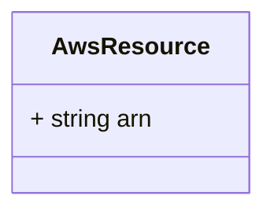
### AwsIamPolicy Diagram

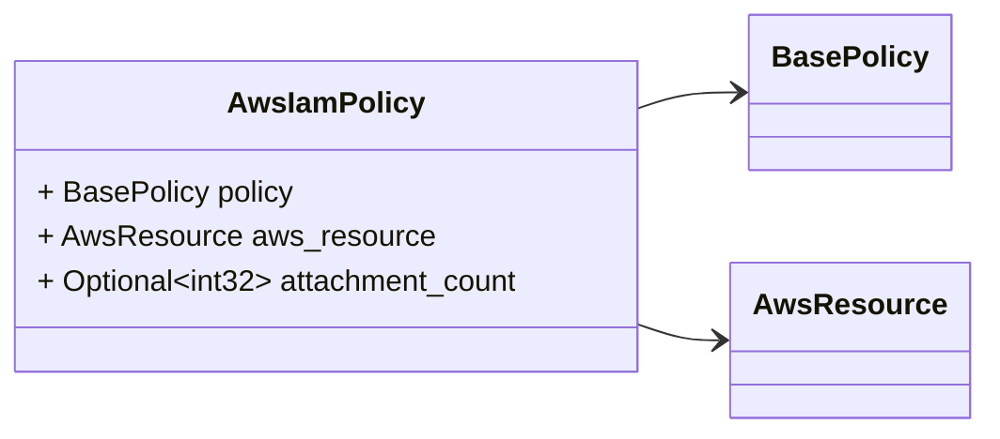
### AwsIamUser Diagram

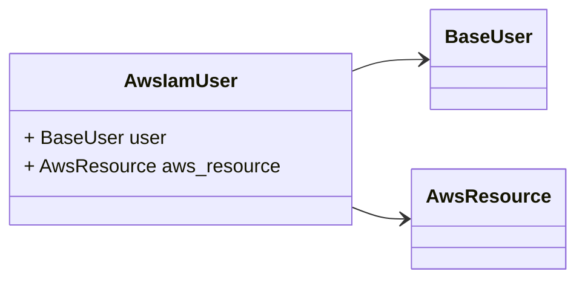
### AwsIamRole Diagram

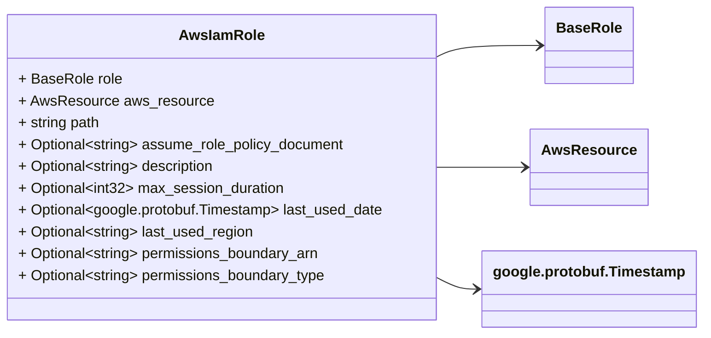
### AwsIamRolePolicyAttachment Diagram

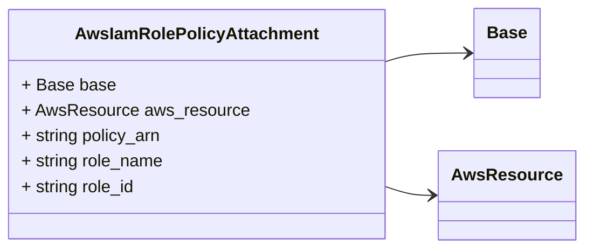
### AwsNetworkInterface Diagram

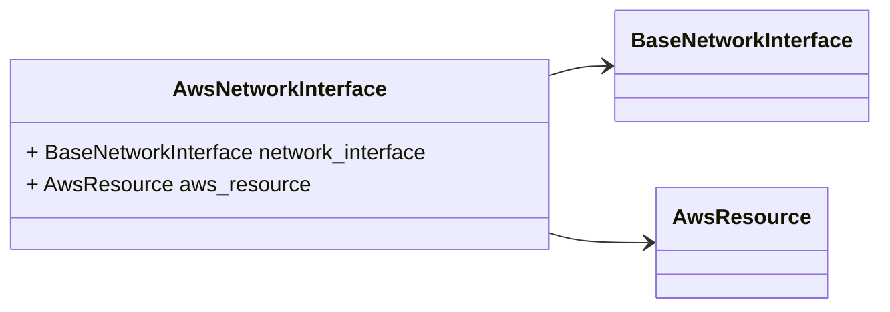
### AwsRegion Diagram

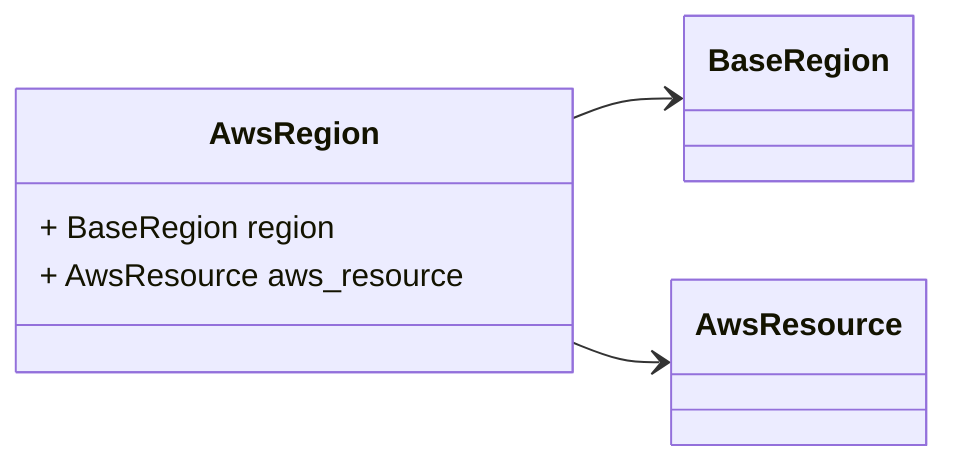
### AwsSecurityGroup Diagram

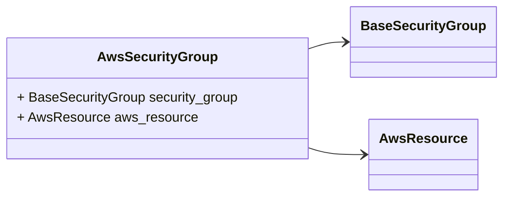
### AwsSecurityGroupRule Diagram

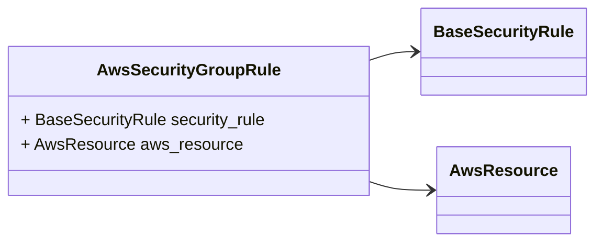
### AwsAvailabilityZone Diagram

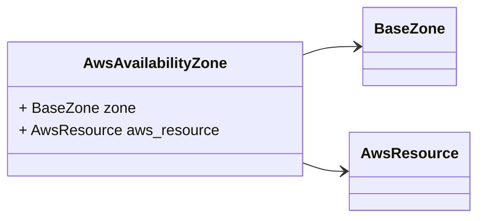
### AwsEc2Instance Diagram

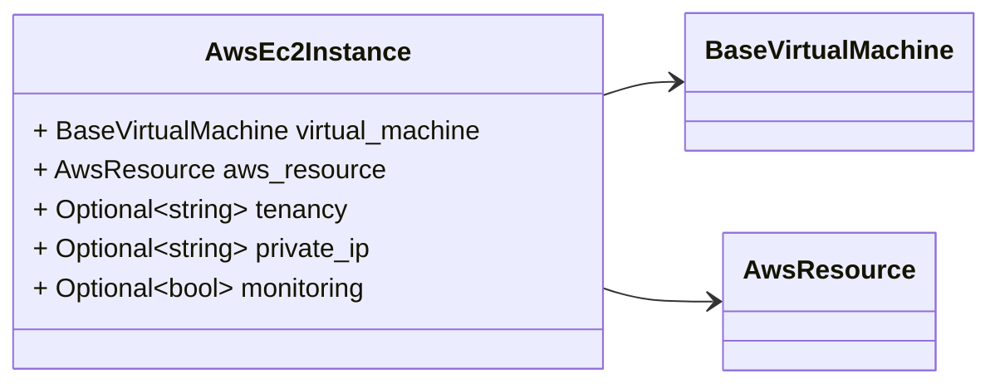
### AwsEc2Volume Diagram

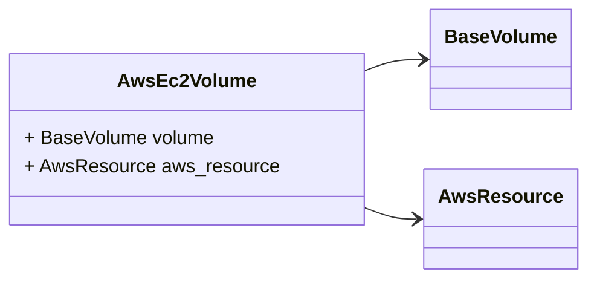
### AwsAmi Diagram

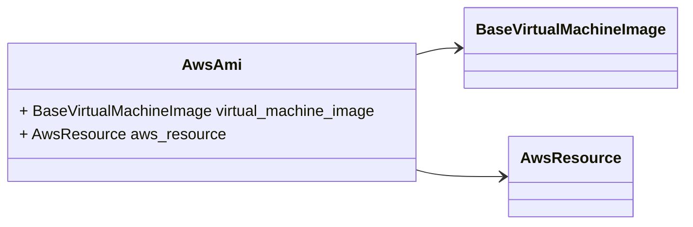
### AwsEcsCluster Diagram

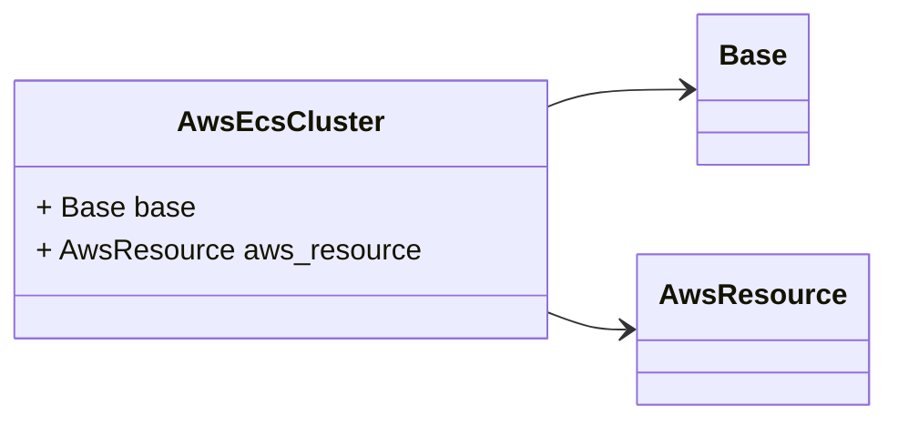
### AwsEcsService Diagram

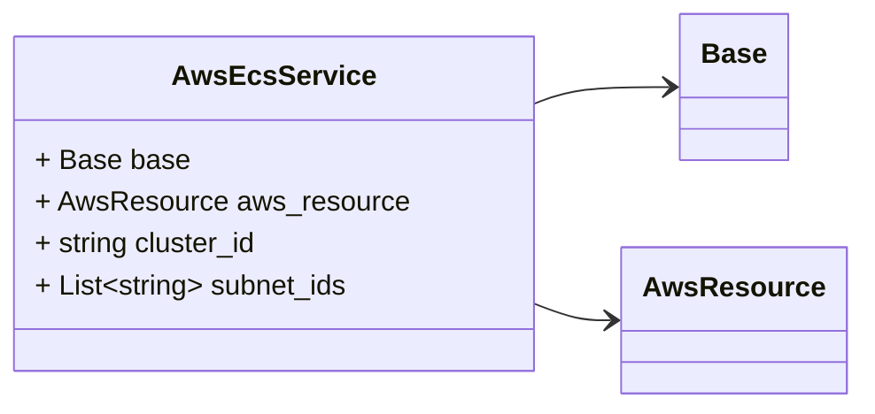
### AwsSubnet Diagram


### AwsVpc Diagram

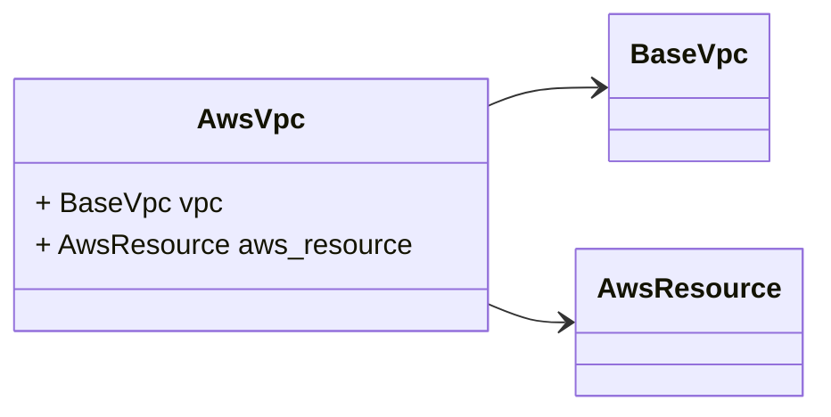
### AwsS3Bucket Diagram

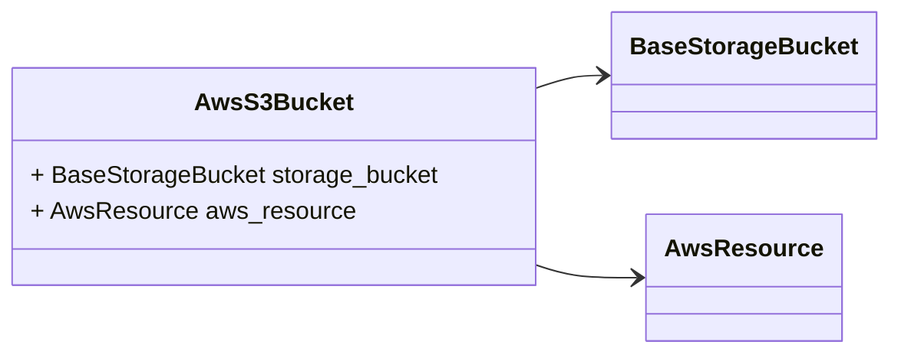
### AwsLambdaFunction Diagram

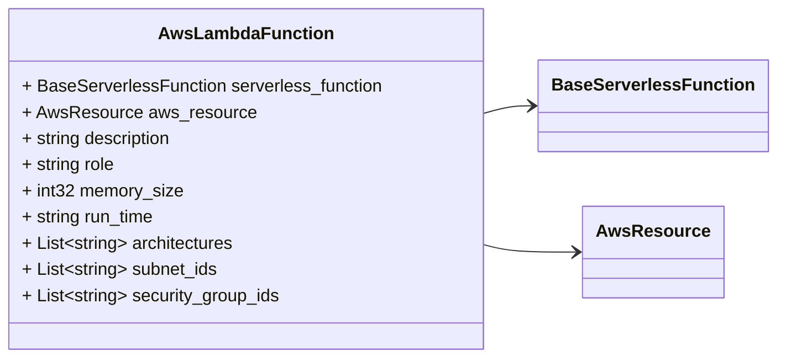
### AwsAccount Diagram

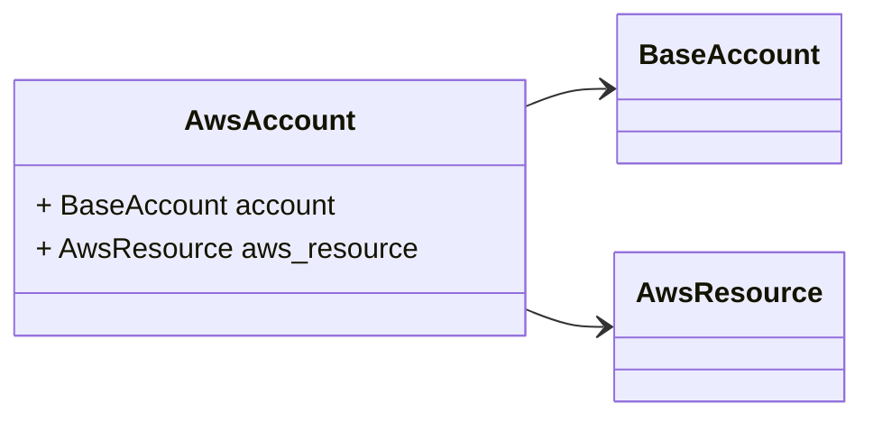
### AwsEc2InstanceType Diagram

```mermaid
classDiagram
direction LR

%% 

class AwsEc2InstanceType {
  + BaseVirtualMachineType virtual_machine_type
  + AwsResource aws_resource
}
AwsEc2InstanceType --> `BaseVirtualMachineType`
AwsEc2InstanceType --> `AwsResource`

```

## Message: AwsResource
<div style="font-size: 12px; margin-top: -10px;" class="fqn">FQN: hashicorp.cloud.internal.infragraph.domain.v1.AwsResource</div>

<div class="comment"><span>AwsResource is a type containing AWS specific fields.</span><br/></div>

| Field | Ordinal | Type   | Label | Description |
|-------|---------|--------|-------|-------------|
| arn   | 2       | string |       |             |


## Message: AwsIamPolicy
<div style="font-size: 12px; margin-top: -10px;" class="fqn">FQN: hashicorp.cloud.internal.infragraph.domain.v1.AwsIamPolicy</div>

<div class="comment"><span></span><br/></div>

| Field            | Ordinal | Type        | Label    | Description |
|------------------|---------|-------------|----------|-------------|
| policy           | 1       | BasePolicy  |          |             |
| aws_resource     | 2       | AwsResource |          |             |
| attachment_count | 3       | int32       | Optional |             |


## Message: AwsIamUser
<div style="font-size: 12px; margin-top: -10px;" class="fqn">FQN: hashicorp.cloud.internal.infragraph.domain.v1.AwsIamUser</div>

<div class="comment"><span></span><br/></div>

| Field        | Ordinal | Type        | Label | Description |
|--------------|---------|-------------|-------|-------------|
| user         | 1       | BaseUser    |       |             |
| aws_resource | 2       | AwsResource |       |             |


## Message: AwsIamRole
<div style="font-size: 12px; margin-top: -10px;" class="fqn">FQN: hashicorp.cloud.internal.infragraph.domain.v1.AwsIamRole</div>

<div class="comment"><span></span><br/></div>

| Field                       | Ordinal | Type                      | Label    | Description |
|-----------------------------|---------|---------------------------|----------|-------------|
| role                        | 1       | BaseRole                  |          |             |
| aws_resource                | 2       | AwsResource               |          |             |
| path                        | 3       | string                    |          |             |
| assume_role_policy_document | 4       | string                    | Optional |             |
| description                 | 5       | string                    | Optional |             |
| max_session_duration        | 6       | int32                     | Optional |             |
| last_used_date              | 7       | google.protobuf.Timestamp | Optional |             |
| last_used_region            | 8       | string                    | Optional |             |
| permissions_boundary_arn    | 9       | string                    | Optional |             |
| permissions_boundary_type   | 10      | string                    | Optional |             |


## Message: AwsIamRolePolicyAttachment
<div style="font-size: 12px; margin-top: -10px;" class="fqn">FQN: hashicorp.cloud.internal.infragraph.domain.v1.AwsIamRolePolicyAttachment</div>

<div class="comment"><span></span><br/></div>

| Field        | Ordinal | Type        | Label | Description |
|--------------|---------|-------------|-------|-------------|
| base         | 1       | Base        |       |             |
| aws_resource | 2       | AwsResource |       |             |
| policy_arn   | 3       | string      |       |             |
| role_name    | 4       | string      |       |             |
| role_id      | 5       | string      |       |             |


## Message: AwsNetworkInterface
<div style="font-size: 12px; margin-top: -10px;" class="fqn">FQN: hashicorp.cloud.internal.infragraph.domain.v1.AwsNetworkInterface</div>

<div class="comment"><span></span><br/></div>

| Field             | Ordinal | Type                 | Label | Description |
|-------------------|---------|----------------------|-------|-------------|
| network_interface | 1       | BaseNetworkInterface |       |             |
| aws_resource      | 2       | AwsResource          |       |             |


## Message: AwsRegion
<div style="font-size: 12px; margin-top: -10px;" class="fqn">FQN: hashicorp.cloud.internal.infragraph.domain.v1.AwsRegion</div>

<div class="comment"><span></span><br/></div>

| Field        | Ordinal | Type        | Label | Description |
|--------------|---------|-------------|-------|-------------|
| region       | 1       | BaseRegion  |       |             |
| aws_resource | 2       | AwsResource |       |             |


## Message: AwsSecurityGroup
<div style="font-size: 12px; margin-top: -10px;" class="fqn">FQN: hashicorp.cloud.internal.infragraph.domain.v1.AwsSecurityGroup</div>

<div class="comment"><span></span><br/></div>

| Field          | Ordinal | Type              | Label | Description |
|----------------|---------|-------------------|-------|-------------|
| security_group | 1       | BaseSecurityGroup |       |             |
| aws_resource   | 2       | AwsResource       |       |             |


## Message: AwsSecurityGroupRule
<div style="font-size: 12px; margin-top: -10px;" class="fqn">FQN: hashicorp.cloud.internal.infragraph.domain.v1.AwsSecurityGroupRule</div>

<div class="comment"><span></span><br/></div>

| Field         | Ordinal | Type             | Label | Description |
|---------------|---------|------------------|-------|-------------|
| security_rule | 1       | BaseSecurityRule |       |             |
| aws_resource  | 2       | AwsResource      |       |             |


## Message: AwsAvailabilityZone
<div style="font-size: 12px; margin-top: -10px;" class="fqn">FQN: hashicorp.cloud.internal.infragraph.domain.v1.AwsAvailabilityZone</div>

<div class="comment"><span></span><br/></div>

| Field        | Ordinal | Type        | Label | Description |
|--------------|---------|-------------|-------|-------------|
| zone         | 1       | BaseZone    |       |             |
| aws_resource | 2       | AwsResource |       |             |


## Message: AwsEc2Instance
<div style="font-size: 12px; margin-top: -10px;" class="fqn">FQN: hashicorp.cloud.internal.infragraph.domain.v1.AwsEc2Instance</div>

<div class="comment"><span>AwsEc2Instance domain model message.</span><br/></div>

| Field           | Ordinal | Type               | Label    | Description |
|-----------------|---------|--------------------|----------|-------------|
| virtual_machine | 1       | BaseVirtualMachine |          |             |
| aws_resource    | 2       | AwsResource        |          |             |
| tenancy         | 3       | string             | Optional |             |
| private_ip      | 4       | string             | Optional |             |
| monitoring      | 5       | bool               | Optional |             |


## Message: AwsEc2Volume
<div style="font-size: 12px; margin-top: -10px;" class="fqn">FQN: hashicorp.cloud.internal.infragraph.domain.v1.AwsEc2Volume</div>

<div class="comment"><span></span><br/></div>

| Field        | Ordinal | Type        | Label | Description |
|--------------|---------|-------------|-------|-------------|
| volume       | 1       | BaseVolume  |       |             |
| aws_resource | 2       | AwsResource |       |             |


## Message: AwsAmi
<div style="font-size: 12px; margin-top: -10px;" class="fqn">FQN: hashicorp.cloud.internal.infragraph.domain.v1.AwsAmi</div>

<div class="comment"><span></span><br/></div>

| Field                 | Ordinal | Type                    | Label | Description |
|-----------------------|---------|-------------------------|-------|-------------|
| virtual_machine_image | 1       | BaseVirtualMachineImage |       |             |
| aws_resource          | 2       | AwsResource             |       |             |


## Message: AwsEcsCluster
<div style="font-size: 12px; margin-top: -10px;" class="fqn">FQN: hashicorp.cloud.internal.infragraph.domain.v1.AwsEcsCluster</div>

<div class="comment"><span></span><br/></div>

| Field        | Ordinal | Type        | Label | Description |
|--------------|---------|-------------|-------|-------------|
| base         | 1       | Base        |       |             |
| aws_resource | 2       | AwsResource |       |             |


## Message: AwsEcsService
<div style="font-size: 12px; margin-top: -10px;" class="fqn">FQN: hashicorp.cloud.internal.infragraph.domain.v1.AwsEcsService</div>

<div class="comment"><span></span><br/></div>

| Field        | Ordinal | Type        | Label    | Description |
|--------------|---------|-------------|----------|-------------|
| base         | 1       | Base        |          |             |
| aws_resource | 2       | AwsResource |          |             |
| cluster_id   | 3       | string      |          |             |
| subnet_ids   | 4       | string      | Repeated |             |


## Message: AwsSubnet
<div style="font-size: 12px; margin-top: -10px;" class="fqn">FQN: hashicorp.cloud.internal.infragraph.domain.v1.AwsSubnet</div>

<div class="comment"><span></span><br/></div>

| Field        | Ordinal | Type        | Label | Description |
|--------------|---------|-------------|-------|-------------|
| subnet       | 1       | BaseSubnet  |       |             |
| aws_resource | 2       | AwsResource |       |             |


## Message: AwsVpc
<div style="font-size: 12px; margin-top: -10px;" class="fqn">FQN: hashicorp.cloud.internal.infragraph.domain.v1.AwsVpc</div>

<div class="comment"><span></span><br/></div>

| Field        | Ordinal | Type        | Label | Description |
|--------------|---------|-------------|-------|-------------|
| vpc          | 1       | BaseVpc     |       |             |
| aws_resource | 2       | AwsResource |       |             |


## Message: AwsS3Bucket
<div style="font-size: 12px; margin-top: -10px;" class="fqn">FQN: hashicorp.cloud.internal.infragraph.domain.v1.AwsS3Bucket</div>

<div class="comment"><span></span><br/></div>

| Field          | Ordinal | Type              | Label | Description |
|----------------|---------|-------------------|-------|-------------|
| storage_bucket | 1       | BaseStorageBucket |       |             |
| aws_resource   | 2       | AwsResource       |       |             |


## Message: AwsLambdaFunction
<div style="font-size: 12px; margin-top: -10px;" class="fqn">FQN: hashicorp.cloud.internal.infragraph.domain.v1.AwsLambdaFunction</div>

<div class="comment"><span></span><br/></div>

| Field               | Ordinal | Type                   | Label    | Description |
|---------------------|---------|------------------------|----------|-------------|
| serverless_function | 1       | BaseServerlessFunction |          |             |
| aws_resource        | 2       | AwsResource            |          |             |
| description         | 3       | string                 |          |             |
| role                | 4       | string                 |          |             |
| memory_size         | 5       | int32                  |          |             |
| run_time            | 6       | string                 |          |             |
| architectures       | 7       | string                 | Repeated |             |
| subnet_ids          | 8       | string                 | Repeated |             |
| security_group_ids  | 9       | string                 | Repeated |             |


## Message: AwsAccount
<div style="font-size: 12px; margin-top: -10px;" class="fqn">FQN: hashicorp.cloud.internal.infragraph.domain.v1.AwsAccount</div>

<div class="comment"><span></span><br/></div>

| Field        | Ordinal | Type        | Label | Description |
|--------------|---------|-------------|-------|-------------|
| account      | 1       | BaseAccount |       |             |
| aws_resource | 2       | AwsResource |       |             |


## Message: AwsEc2InstanceType
<div style="font-size: 12px; margin-top: -10px;" class="fqn">FQN: hashicorp.cloud.internal.infragraph.domain.v1.AwsEc2InstanceType</div>

<div class="comment"><span></span><br/></div>

| Field                | Ordinal | Type                   | Label | Description |
|----------------------|---------|------------------------|-------|-------------|
| virtual_machine_type | 1       | BaseVirtualMachineType |       |             |
| aws_resource         | 2       | AwsResource            |       |             |


<!-- Created by: Proto Diagram Tool -->
<!-- https://github.com/GoogleCloudPlatform/proto-gen-md-diagrams -->
