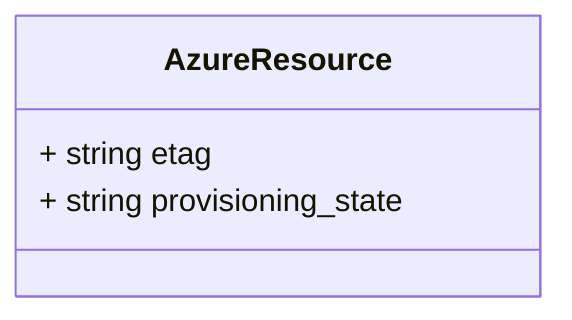
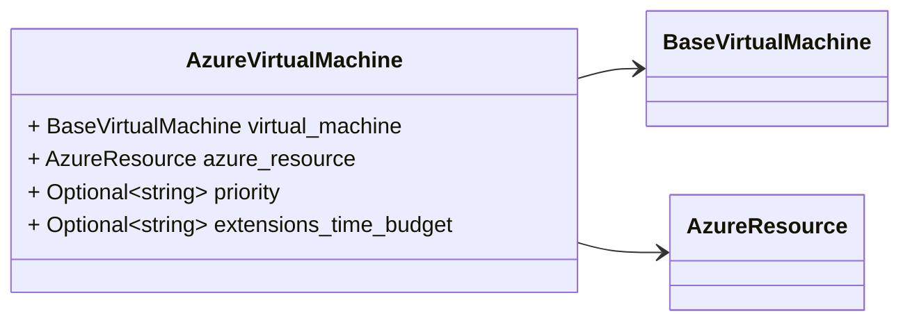

# Package: hashicorp.cloud.internal.infragraph.domain.v1

 

## Imports

| Import                                                       | Description |
|--------------------------------------------------------------|-------------|
| hashicorp/cloud/internal/infragraph/domain/v1/base.proto     |             |
| hashicorp/cloud/internal/infragraph/options/v1/options.proto |             |

## Options

| Name       | Value                                                   | Description |
|------------|---------------------------------------------------------|-------------|
| go_package | github.com/hashicorp/cloud-infragraph/proto-internal/go |             |

### AzureResource Diagram

### AzureVirtualMachine Diagram

## Message: AzureResource

FQN: hashicorp.cloud.internal.infragraph.domain.v1.AzureResource

AzureResource is a type containing Azure specific fields for all resources. 

| Field              | Ordinal | Type   | Label | Description           |
|--------------------|---------|--------|-------|-----------------------|
| etag               | 1       | string |       | type specific fields  |
| provisioning_state | 2       | string |       |                       |

## Message: AzureVirtualMachine

FQN: hashicorp.cloud.internal.infragraph.domain.v1.AzureVirtualMachine

AzureVirtualMachine domain model message. 

| Field                  | Ordinal | Type               | Label    | Description           |
|------------------------|---------|--------------------|----------|-----------------------|
| virtual_machine        | 1       | BaseVirtualMachine |          | inherited types       |
| azure_resource         | 2       | AzureResource      |          |                       |
| priority               | 3       | string             | Optional | type specific fields  |
| extensions_time_budget | 4       | string             | Optional |                       |

<!-- Created by: Proto Diagram Tool -->
<!-- https://github.com/GoogleCloudPlatform/proto-gen-md-diagrams -->
