# Package: hashicorp.cloud.internal.infragraph.domain.v1

<div class="comment"><span></span><br/></div>

## Imports

| Import                                                       | Description |
|--------------------------------------------------------------|-------------|
| google/protobuf/timestamp.proto                              |             |
| hashicorp/cloud/internal/infragraph/options/v1/options.proto |             |


## Options

| Name       | Value                                                   | Description |
|------------|---------------------------------------------------------|-------------|
| go_package | github.com/hashicorp/cloud-infragraph/proto-internal/go |             |


## Enum: Source
<div style="font-size: 12px; margin-top: -10px;" class="fqn">FQN: hashicorp.cloud.internal.infragraph.domain.v1.Source</div>

<div class="comment"><span></span><br/></div>

| Name                 | Ordinal | Description |
|----------------------|---------|-------------|
| SOURCE_UNSPECIFIED   | 0       |             |
| SOURCE_AWS           | 1       |             |
| SOURCE_AZURE         | 2       |             |
| SOURCE_GCP           | 3       |             |
| SOURCE_HCP_PACKER    | 4       |             |
| SOURCE_HCP_TERRAFORM | 5       |             |
| SOURCE_HCP           | 6       |             |


## Enum: Kind
<div style="font-size: 12px; margin-top: -10px;" class="fqn">FQN: hashicorp.cloud.internal.infragraph.domain.v1.Kind</div>

<div class="comment"><span></span><br/></div>

| Name                             | Ordinal | Description |
|----------------------------------|---------|-------------|
| KIND_UNSPECIFIED                 | 0       |             |
| KIND_VIRTUAL_MACHINE             | 1       |             |
| KIND_ACCOUNT                     | 2       |             |
| KIND_REGION                      | 3       |             |
| KIND_ZONE                        | 4       |             |
| KIND_VIRTUAL_NETWORK             | 5       |             |
| KIND_SUBNET                      | 6       |             |
| KIND_NETWORK_INTERFACE           | 7       |             |
| KIND_VIRTUAL_MACHINE_IMAGE       | 8       |             |
| KIND_ECS_CLUSTER                 | 9       |             |
| KIND_ECS_SERVICE                 | 10      |             |
| KIND_PACKER_BUCKET               | 11      |             |
| KIND_PACKER_REGISTRY             | 12      |             |
| KIND_POLICY                      | 13      |             |
| KIND_USER                        | 14      |             |
| KIND_STORAGE_BUCKET              | 15      |             |
| KIND_VOLUME                      | 16      |             |
| KIND_SECURITY_GROUP              | 17      |             |
| KIND_SECURITY_RULE               | 171     |             |
| KIND_PACKER_BUILD                | 18      |             |
| KIND_PACKER_SBOM                 | 19      |             |
| KIND_PACKER_VERSION              | 20      |             |
| KIND_PACKER_SOURCE               | 21      |             |
| KIND_SERVERLESS_FUNCTION         | 22      |             |
| KIND_PACKER_INHERITED_REVOCATION | 23      |             |
| KIND_PACKER_ANCESTRY             | 233     |             |
| KIND_PACKER_CHANNEL              | 24      |             |
| KIND_PACKER_ARTIFACT             | 26      |             |
| KIND_ORGANIZATION                | 27      |             |
| KIND_HCP_TERRAFORM_STATE_VERSION | 28      |             |
| KIND_VIRTUAL_MACHINE_TYPE        | 29      |             |
| KIND_HCP_TERRAFORM_WORKSPACE     | 30      |             |
| KIND_HCP_TERRAFORM_ORGANIZATION  | 31      |             |
| KIND_HCP_TERRAFORM_AGENT_POOL    | 32      |             |
| KIND_HCP_TERRAFORM_RUN           | 33      |             |
| KIND_ROLE                        | 34      |             |
| KIND_ROLE_POLICY_ATTACHMENT      | 35      |             |


### Source Diagram

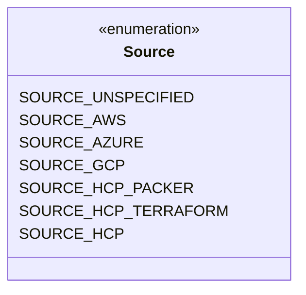
### Kind Diagram

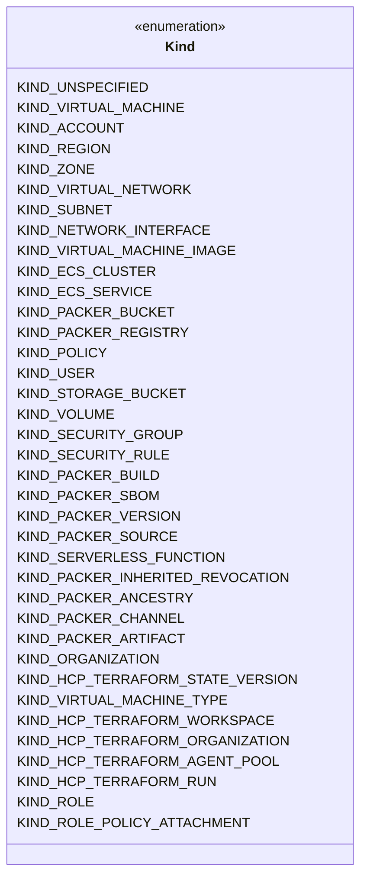
### Base Diagram

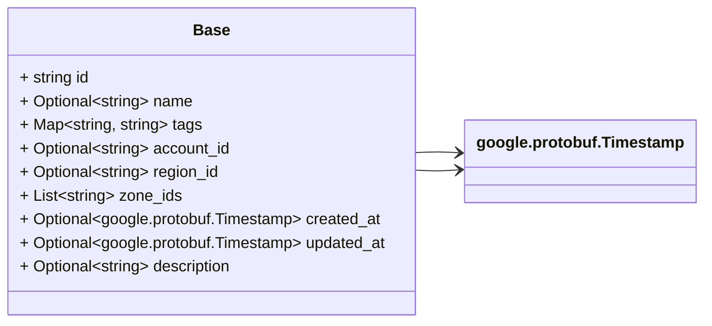
### BaseNetworkInterface Diagram

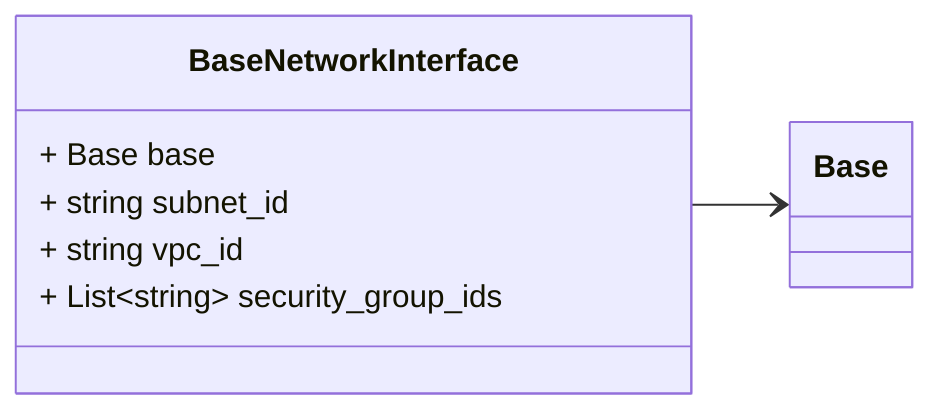
### BasePolicy Diagram

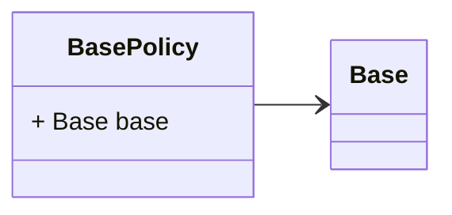
### BaseRole Diagram

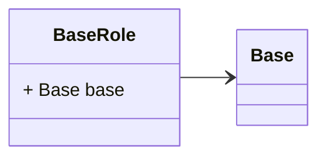
### BaseRegion Diagram

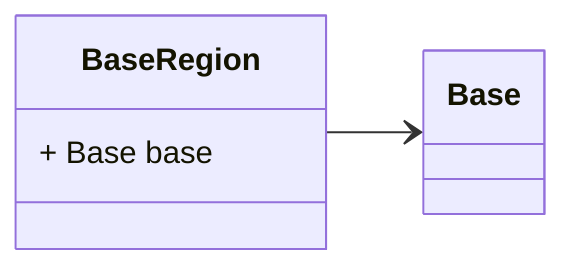
### BaseSecurityGroup Diagram

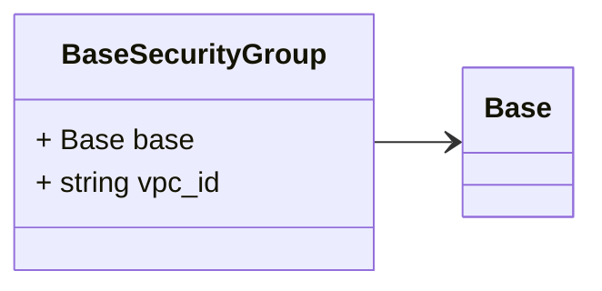
### BaseSecurityRule Diagram

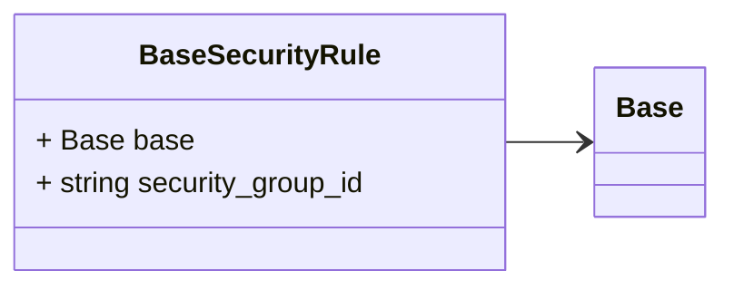
### BaseSubnet Diagram

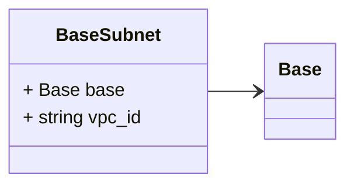
### BaseUser Diagram

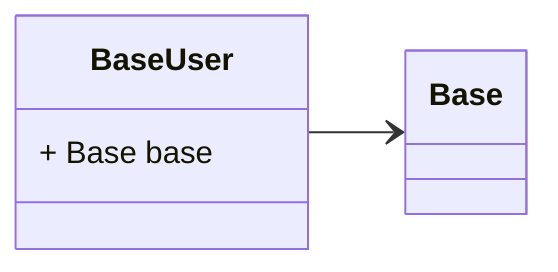
### BaseVpc Diagram

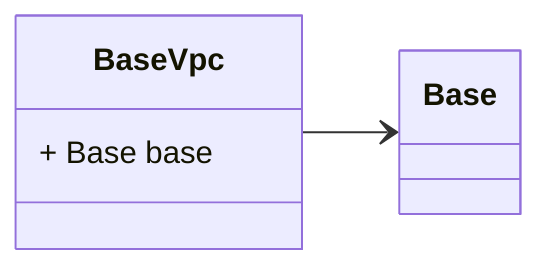
### BaseZone Diagram


### BaseVirtualMachine Diagram

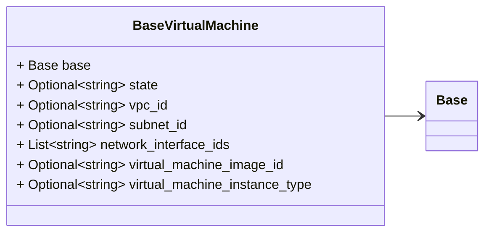
### BaseVirtualMachineImage Diagram

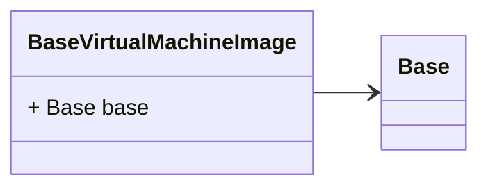
### BaseStorageBucket Diagram

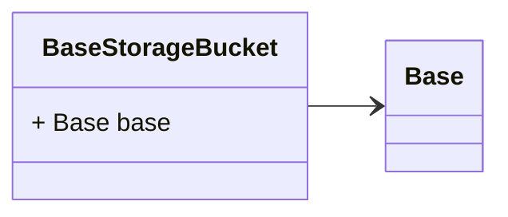
### BaseVolume Diagram

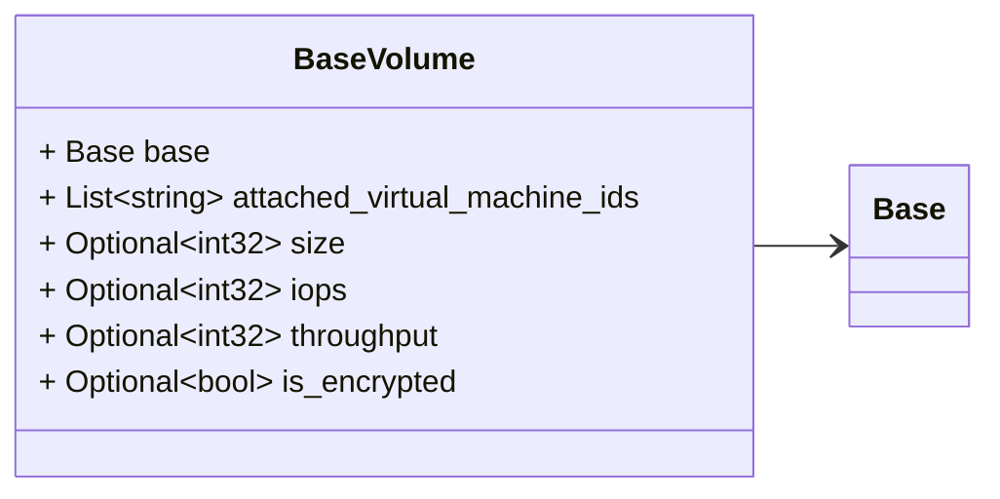
### BaseServerlessFunction Diagram

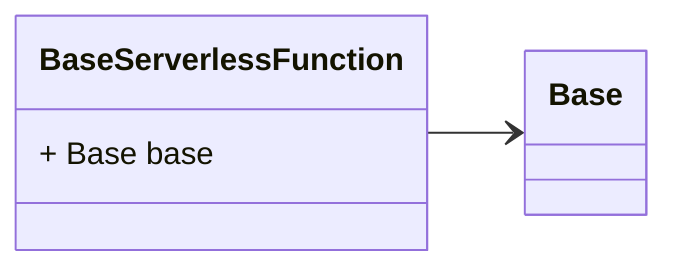
### BaseOrganization Diagram

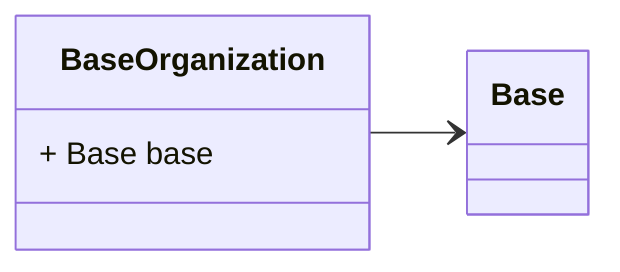
### BaseAccount Diagram

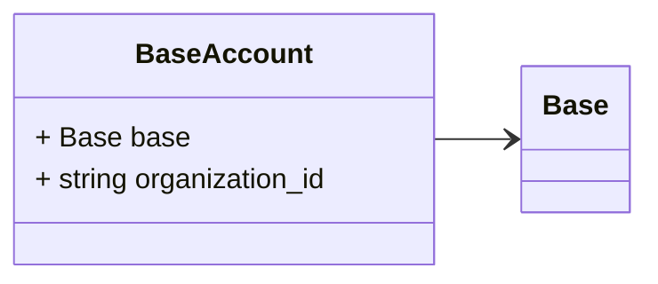
### BaseVirtualMachineType Diagram

```mermaid
classDiagram
direction LR

%% BaseVirtualMachineType is a base type all virtual machine types are expected to embed.

class BaseVirtualMachineType {
  + Base base
}
BaseVirtualMachineType --> `Base`

```

## Message: Base
<div style="font-size: 12px; margin-top: -10px;" class="fqn">FQN: hashicorp.cloud.internal.infragraph.domain.v1.Base</div>

<div class="comment"><span>Base is a base all domain models are expected to embed.</span><br/></div>

| Field       | Ordinal | Type                      | Label    | Description                                                               |
|-------------|---------|---------------------------|----------|---------------------------------------------------------------------------|
| id          | 1       | string                    |          | the unique identifier in the source system                                |
| name        | 3       | string                    | Optional | the name of the model in the source system                                |
| tags        | 5       | string, string            | Map      | tags are key/value pairs that are used to identify and organize types     |
| account_id  | 6       | string                    | Optional | unique identifier of the container holding the type in the source system  |
| region_id   | 7       | string                    | Optional | unique identifier of the region holding the type in the source system     |
| zone_ids    | 8       | string                    | Repeated | unique identifier of the zone holding the type in the source system       |
| created_at  | 9       | google.protobuf.Timestamp | Optional |                                                                           |
| updated_at  | 10      | google.protobuf.Timestamp | Optional |                                                                           |
| description | 11      | string                    | Optional |                                                                           |


## Message: BaseNetworkInterface
<div style="font-size: 12px; margin-top: -10px;" class="fqn">FQN: hashicorp.cloud.internal.infragraph.domain.v1.BaseNetworkInterface</div>

<div class="comment"><span></span><br/></div>

| Field              | Ordinal | Type   | Label    | Description                                       |
|--------------------|---------|--------|----------|---------------------------------------------------|
| base               | 1       | Base   |          |                                                   |
| subnet_id          | 3       | string |          | the subnet the network interface is contained in  |
| vpc_id             | 4       | string |          | the VPC the network interface is contained in     |
| security_group_ids | 5       | string | Repeated |                                                   |


## Message: BasePolicy
<div style="font-size: 12px; margin-top: -10px;" class="fqn">FQN: hashicorp.cloud.internal.infragraph.domain.v1.BasePolicy</div>

<div class="comment"><span></span><br/></div>

| Field | Ordinal | Type | Label | Description |
|-------|---------|------|-------|-------------|
| base  | 1       | Base |       |             |


## Message: BaseRole
<div style="font-size: 12px; margin-top: -10px;" class="fqn">FQN: hashicorp.cloud.internal.infragraph.domain.v1.BaseRole</div>

<div class="comment"><span></span><br/></div>

| Field | Ordinal | Type | Label | Description |
|-------|---------|------|-------|-------------|
| base  | 1       | Base |       |             |


## Message: BaseRegion
<div style="font-size: 12px; margin-top: -10px;" class="fqn">FQN: hashicorp.cloud.internal.infragraph.domain.v1.BaseRegion</div>

<div class="comment"><span></span><br/></div>

| Field | Ordinal | Type | Label | Description |
|-------|---------|------|-------|-------------|
| base  | 1       | Base |       |             |


## Message: BaseSecurityGroup
<div style="font-size: 12px; margin-top: -10px;" class="fqn">FQN: hashicorp.cloud.internal.infragraph.domain.v1.BaseSecurityGroup</div>

<div class="comment"><span></span><br/></div>

| Field  | Ordinal | Type   | Label | Description                                 |
|--------|---------|--------|-------|---------------------------------------------|
| base   | 1       | Base   |       |                                             |
| vpc_id | 2       | string |       | the VPC the security group is contained in  |


## Message: BaseSecurityRule
<div style="font-size: 12px; margin-top: -10px;" class="fqn">FQN: hashicorp.cloud.internal.infragraph.domain.v1.BaseSecurityRule</div>

<div class="comment"><span></span><br/></div>

| Field             | Ordinal | Type   | Label | Description                              |
|-------------------|---------|--------|-------|------------------------------------------|
| base              | 1       | Base   |       |                                          |
| security_group_id | 2       | string |       | the security group this rule applies to  |


## Message: BaseSubnet
<div style="font-size: 12px; margin-top: -10px;" class="fqn">FQN: hashicorp.cloud.internal.infragraph.domain.v1.BaseSubnet</div>

<div class="comment"><span></span><br/></div>

| Field  | Ordinal | Type   | Label | Description                         |
|--------|---------|--------|-------|-------------------------------------|
| base   | 1       | Base   |       |                                     |
| vpc_id | 2       | string |       | the VPC the subnet is contained in  |


## Message: BaseUser
<div style="font-size: 12px; margin-top: -10px;" class="fqn">FQN: hashicorp.cloud.internal.infragraph.domain.v1.BaseUser</div>

<div class="comment"><span></span><br/></div>

| Field | Ordinal | Type | Label | Description |
|-------|---------|------|-------|-------------|
| base  | 1       | Base |       |             |


## Message: BaseVpc
<div style="font-size: 12px; margin-top: -10px;" class="fqn">FQN: hashicorp.cloud.internal.infragraph.domain.v1.BaseVpc</div>

<div class="comment"><span></span><br/></div>

| Field | Ordinal | Type | Label | Description |
|-------|---------|------|-------|-------------|
| base  | 1       | Base |       |             |


## Message: BaseZone
<div style="font-size: 12px; margin-top: -10px;" class="fqn">FQN: hashicorp.cloud.internal.infragraph.domain.v1.BaseZone</div>

<div class="comment"><span></span><br/></div>

| Field | Ordinal | Type | Label | Description |
|-------|---------|------|-------|-------------|
| base  | 1       | Base |       |             |


## Message: BaseVirtualMachine
<div style="font-size: 12px; margin-top: -10px;" class="fqn">FQN: hashicorp.cloud.internal.infragraph.domain.v1.BaseVirtualMachine</div>

<div class="comment"><span>BaseVirtualMachine is a base type all virtual machines are expected to embed.</span><br/></div>

| Field                         | Ordinal | Type   | Label    | Description                                                          |
|-------------------------------|---------|--------|----------|----------------------------------------------------------------------|
| base                          | 1       | Base   |          |                                                                      |
| state                         | 2       | string | Optional | the state of the virtual machine                                     |
| vpc_id                        | 3       | string | Optional | the vpc the virtual machine is contained in                          |
| subnet_id                     | 4       | string | Optional | the subnet the virtual machine is contained in                       |
| network_interface_ids         | 5       | string | Repeated | the network interfaces the virtual machine is connected to           |
| virtual_machine_image_id      | 6       | string | Optional | the virtual machine image that the virtual machine runs              |
| virtual_machine_instance_type | 7       | string | Optional | the virtual machine type that the virtual machine is an instance of  |


## Message: BaseVirtualMachineImage
<div style="font-size: 12px; margin-top: -10px;" class="fqn">FQN: hashicorp.cloud.internal.infragraph.domain.v1.BaseVirtualMachineImage</div>

<div class="comment"><span>BaseVirtualMachineImage is a base type all virtual machine images are expected to embed.</span><br/></div>

| Field | Ordinal | Type | Label | Description |
|-------|---------|------|-------|-------------|
| base  | 1       | Base |       |             |


## Message: BaseStorageBucket
<div style="font-size: 12px; margin-top: -10px;" class="fqn">FQN: hashicorp.cloud.internal.infragraph.domain.v1.BaseStorageBucket</div>

<div class="comment"><span>BaseStorageBucket is a base type all storage buckets are expected to embed.</span><br/></div>

| Field | Ordinal | Type | Label | Description |
|-------|---------|------|-------|-------------|
| base  | 1       | Base |       |             |


## Message: BaseVolume
<div style="font-size: 12px; margin-top: -10px;" class="fqn">FQN: hashicorp.cloud.internal.infragraph.domain.v1.BaseVolume</div>

<div class="comment"><span>BaseVolume is a base type all volumes are expected to embed.</span><br/></div>

| Field                        | Ordinal | Type   | Label    | Description                                      |
|------------------------------|---------|--------|----------|--------------------------------------------------|
| base                         | 1       | Base   |          |                                                  |
| attached_virtual_machine_ids | 2       | string | Repeated | the virtual machines this volume is attached to  |
| size                         | 3       | int32  | Optional | size of the volume in GiB                        |
| iops                         | 4       | int32  | Optional | input/output operations per second               |
| throughput                   | 5       | int32  | Optional | throghput in MB/s                                |
| is_encrypted                 | 6       | bool   | Optional | flag indicating if the volume is encrypted       |


## Message: BaseServerlessFunction
<div style="font-size: 12px; margin-top: -10px;" class="fqn">FQN: hashicorp.cloud.internal.infragraph.domain.v1.BaseServerlessFunction</div>

<div class="comment"><span>BaseServerlessFunction is a base type all serverless functions are expected to embed.</span><br/></div>

| Field | Ordinal | Type | Label | Description |
|-------|---------|------|-------|-------------|
| base  | 1       | Base |       |             |


## Message: BaseOrganization
<div style="font-size: 12px; margin-top: -10px;" class="fqn">FQN: hashicorp.cloud.internal.infragraph.domain.v1.BaseOrganization</div>

<div class="comment"><span>BaseOrganization is a base type all organizations are expected to embed.</span><br/></div>

| Field | Ordinal | Type | Label | Description |
|-------|---------|------|-------|-------------|
| base  | 1       | Base |       |             |


## Message: BaseAccount
<div style="font-size: 12px; margin-top: -10px;" class="fqn">FQN: hashicorp.cloud.internal.infragraph.domain.v1.BaseAccount</div>

<div class="comment"><span>BaseAccount is a base type all accounts are expected to embed. examples: AWS account, GCP project, HCP project.</span><br/></div>

| Field           | Ordinal | Type   | Label | Description |
|-----------------|---------|--------|-------|-------------|
| base            | 1       | Base   |       |             |
| organization_id | 2       | string |       |             |


## Message: BaseVirtualMachineType
<div style="font-size: 12px; margin-top: -10px;" class="fqn">FQN: hashicorp.cloud.internal.infragraph.domain.v1.BaseVirtualMachineType</div>

<div class="comment"><span>BaseVirtualMachineType is a base type all virtual machine types are expected to embed.</span><br/></div>

| Field | Ordinal | Type | Label | Description |
|-------|---------|------|-------|-------------|
| base  | 1       | Base |       |             |


<!-- Created by: Proto Diagram Tool -->
<!-- https://github.com/GoogleCloudPlatform/proto-gen-md-diagrams -->
