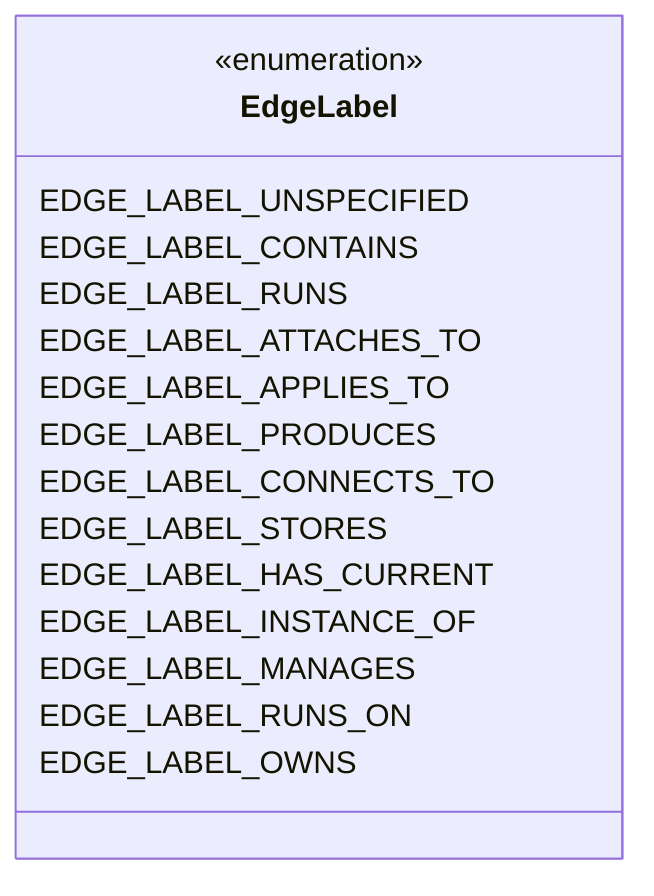
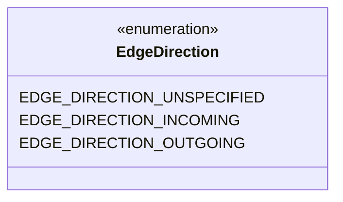
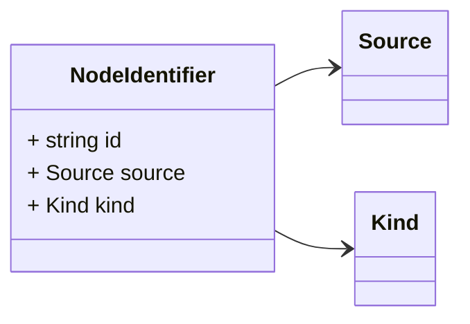
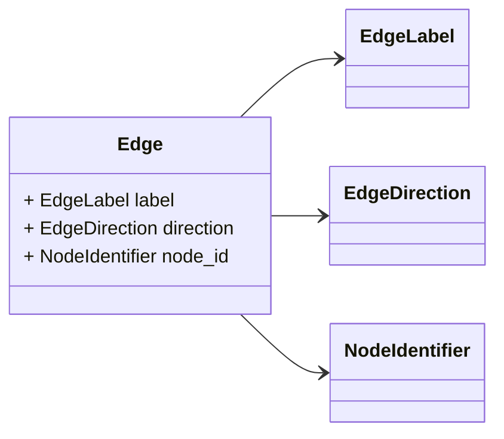

# Package: hashicorp.cloud.internal.infragraph.domain.v1

 

## Imports

| Import                                                   | Description |
|----------------------------------------------------------|-------------|
| hashicorp/cloud/internal/infragraph/domain/v1/base.proto |             |

## Options

| Name       | Value                                                   | Description |
|------------|---------------------------------------------------------|-------------|
| go_package | github.com/hashicorp/cloud-infragraph/proto-internal/go |             |

## Enum: EdgeLabel

FQN: hashicorp.cloud.internal.infragraph.domain.v1.EdgeLabel

EdgeLabel is a label that describes the relationship between nodes in the graph. 

| Name                   | Ordinal | Description |
|------------------------|---------|-------------|
| EDGE_LABEL_UNSPECIFIED | 0       |             |
| EDGE_LABEL_CONTAINS    | 1       |             |
| EDGE_LABEL_RUNS        | 2       |             |
| EDGE_LABEL_ATTACHES_TO | 4       |             |
| EDGE_LABEL_APPLIES_TO  | 5       |             |
| EDGE_LABEL_PRODUCES    | 6       |             |
| EDGE_LABEL_CONNECTS_TO | 7       |             |
| EDGE_LABEL_STORES      | 8       |             |
| EDGE_LABEL_HAS_CURRENT | 9       |             |
| EDGE_LABEL_INSTANCE_OF | 10      |             |
| EDGE_LABEL_MANAGES     | 11      |             |
| EDGE_LABEL_RUNS_ON     | 12      |             |
| EDGE_LABEL_OWNS        | 13      |             |

## Enum: EdgeDirection

FQN: hashicorp.cloud.internal.infragraph.domain.v1.EdgeDirection

EdgeDirection indicates the direction of the edge in the graph. 

| Name                       | Ordinal | Description |
|----------------------------|---------|-------------|
| EDGE_DIRECTION_UNSPECIFIED | 0       |             |
| EDGE_DIRECTION_INCOMING    | 1       |             |
| EDGE_DIRECTION_OUTGOING    | 2       |             |

### EdgeLabel Diagram

### EdgeDirection Diagram

### NodeIdentifier Diagram

### Edge Diagram

## Message: NodeIdentifier

FQN: hashicorp.cloud.internal.infragraph.domain.v1.NodeIdentifier

NodeIdentifier encompasses values that uniquely identify a node in the graph. 

| Field  | Ordinal | Type   | Label | Description |
|--------|---------|--------|-------|-------------|
| id     | 1       | string |       |             |
| source | 2       | Source |       |             |
| kind   | 3       | Kind   |       |             |

## Message: Edge

FQN: hashicorp.cloud.internal.infragraph.domain.v1.Edge

Edge is a representation of a directed edge out or into a node in the graph. 

| Field     | Ordinal | Type           | Label | Description |
|-----------|---------|----------------|-------|-------------|
| label     | 1       | EdgeLabel      |       |             |
| direction | 2       | EdgeDirection  |       |             |
| node_id   | 3       | NodeIdentifier |       |             |

<!-- Created by: Proto Diagram Tool -->
<!-- https://github.com/GoogleCloudPlatform/proto-gen-md-diagrams -->
