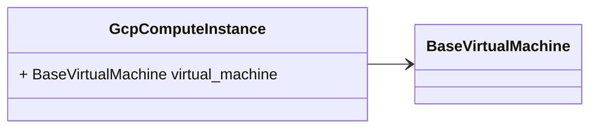

# Package: hashicorp.cloud.internal.infragraph.domain.v1

 

## Imports

| Import                                                       | Description |
|--------------------------------------------------------------|-------------|
| hashicorp/cloud/internal/infragraph/domain/v1/base.proto     |             |
| hashicorp/cloud/internal/infragraph/options/v1/options.proto |             |

## Options

| Name       | Value                                                   | Description |
|------------|---------------------------------------------------------|-------------|
| go_package | github.com/hashicorp/cloud-infragraph/proto-internal/go |             |

### GcpComputeInstance Diagram

## Message: GcpComputeInstance

FQN: hashicorp.cloud.internal.infragraph.domain.v1.GcpComputeInstance

GcpComputeInstance domain model message. 

| Field           | Ordinal | Type               | Label | Description |
|-----------------|---------|--------------------|-------|-------------|
| virtual_machine | 1       | BaseVirtualMachine |       |             |

<!-- Created by: Proto Diagram Tool -->
<!-- https://github.com/GoogleCloudPlatform/proto-gen-md-diagrams -->
