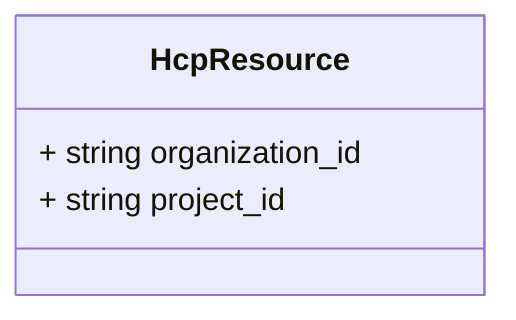
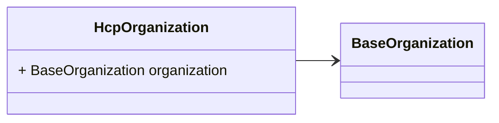
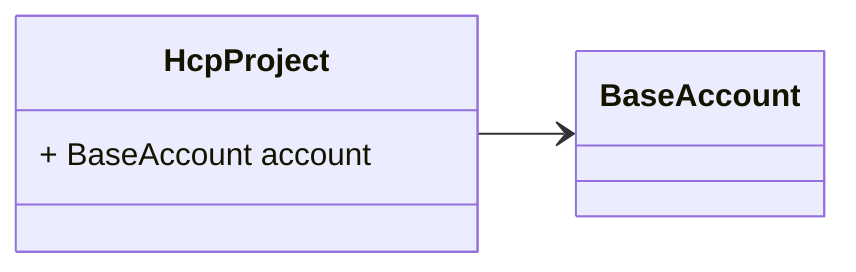

# Package: hashicorp.cloud.internal.infragraph.domain.v1

 

## Imports

| Import                                                       | Description |
|--------------------------------------------------------------|-------------|
| hashicorp/cloud/internal/infragraph/domain/v1/base.proto     |             |
| hashicorp/cloud/internal/infragraph/options/v1/options.proto |             |

## Options

| Name       | Value                                                   | Description |
|------------|---------------------------------------------------------|-------------|
| go_package | github.com/hashicorp/cloud-infragraph/proto-internal/go |             |

### HcpResource Diagram

### HcpOrganization Diagram

### HcpProject Diagram

## Message: HcpResource

FQN: hashicorp.cloud.internal.infragraph.domain.v1.HcpResource

HcpResource is a type containing HCP specific fields. 

| Field           | Ordinal | Type   | Label | Description                             |
|-----------------|---------|--------|-------|-----------------------------------------|
| organization_id | 1       | string |       | organization_id that owns the resource  |
| project_id      | 2       | string |       | project_id the resource belongs to      |

## Message: HcpOrganization

FQN: hashicorp.cloud.internal.infragraph.domain.v1.HcpOrganization

HcpOrganization is a type containing HCP Organization specific fields. 

| Field        | Ordinal | Type             | Label | Description |
|--------------|---------|------------------|-------|-------------|
| organization | 1       | BaseOrganization |       |             |

## Message: HcpProject

FQN: hashicorp.cloud.internal.infragraph.domain.v1.HcpProject

HcpProject is a type containing HCP Project specific fields. 

| Field   | Ordinal | Type        | Label | Description |
|---------|---------|-------------|-------|-------------|
| account | 1       | BaseAccount |       |             |

<!-- Created by: Proto Diagram Tool -->
<!-- https://github.com/GoogleCloudPlatform/proto-gen-md-diagrams -->
