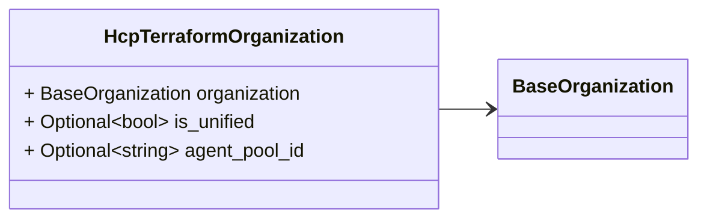
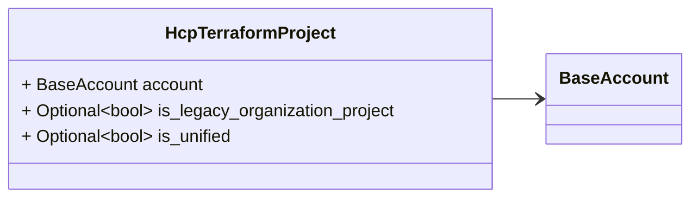
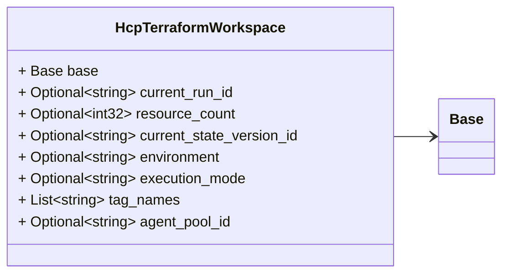
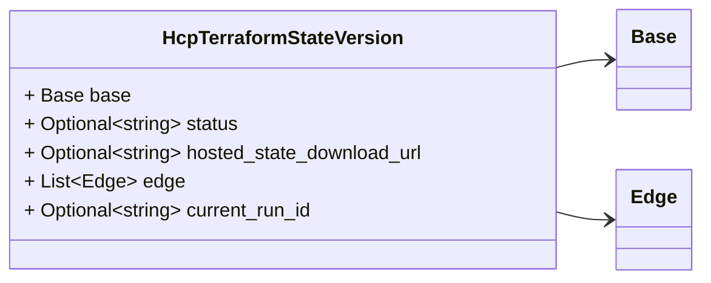
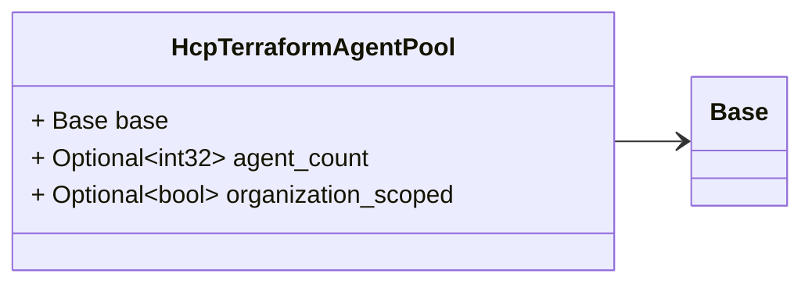
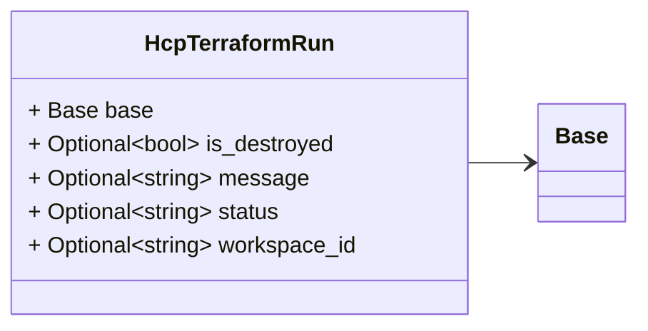

# Package: hashicorp.cloud.internal.infragraph.domain.v1

 

## Imports

| Import                                                       | Description |
|--------------------------------------------------------------|-------------|
| hashicorp/cloud/internal/infragraph/domain/v1/base.proto     |             |
| hashicorp/cloud/internal/infragraph/domain/v1/edge.proto     |             |
| hashicorp/cloud/internal/infragraph/options/v1/options.proto |             |

## Options

| Name       | Value                                                   | Description |
|------------|---------------------------------------------------------|-------------|
| go_package | github.com/hashicorp/cloud-infragraph/proto-internal/go |             |

### HcpTerraformOrganization Diagram

### HcpTerraformProject Diagram

### HcpTerraformWorkspace Diagram

### HcpTerraformStateVersion Diagram

### HcpTerraformAgentPool Diagram

### HcpTerraformRun Diagram

## Message: HcpTerraformOrganization

FQN: hashicorp.cloud.internal.infragraph.domain.v1.HcpTerraformOrganization

HcpTerraformOrganization is a type containing HCP TF Organization specific fields. 

| Field         | Ordinal | Type             | Label    | Description |
|---------------|---------|------------------|----------|-------------|
| organization  | 1       | BaseOrganization |          |             |
| is_unified    | 2       | bool             | Optional |             |
| agent_pool_id | 3       | string           | Optional |             |

## Message: HcpTerraformProject

FQN: hashicorp.cloud.internal.infragraph.domain.v1.HcpTerraformProject

HcpTerraformProject is a type containing HCP TF Project specific fields. 

| Field                          | Ordinal | Type        | Label    | Description |
|--------------------------------|---------|-------------|----------|-------------|
| account                        | 1       | BaseAccount |          |             |
| is_legacy_organization_project | 2       | bool        | Optional |             |
| is_unified                     | 3       | bool        | Optional |             |

## Message: HcpTerraformWorkspace

FQN: hashicorp.cloud.internal.infragraph.domain.v1.HcpTerraformWorkspace

Workspace is a type containing Terraform Workspace specific fields. 

| Field                    | Ordinal | Type   | Label    | Description                                    |
|--------------------------|---------|--------|----------|------------------------------------------------|
| base                     | 1       | Base   |          |                                                |
| current_run_id           | 2       | string | Optional |                                                |
| resource_count           | 3       | int32  | Optional |                                                |
| current_state_version_id | 4       | string | Optional | the current state version id of the workspace  |
| environment              | 5       | string | Optional |                                                |
| execution_mode           | 6       | string | Optional |                                                |
| tag_names                | 7       | string | Repeated |                                                |
| agent_pool_id            | 8       | string | Optional |                                                |

## Message: HcpTerraformStateVersion

FQN: hashicorp.cloud.internal.infragraph.domain.v1.HcpTerraformStateVersion

StateVersion is a type containing HCP State Version specific fields. 

| Field                     | Ordinal | Type   | Label    | Description |
|---------------------------|---------|--------|----------|-------------|
| base                      | 1       | Base   |          |             |
| status                    | 2       | string | Optional |             |
| hosted_state_download_url | 3       | string | Optional |             |
| edge                      | 4       | Edge   | Repeated |             |
| current_run_id            | 5       | string | Optional |             |

## Message: HcpTerraformAgentPool

FQN: hashicorp.cloud.internal.infragraph.domain.v1.HcpTerraformAgentPool

 

| Field               | Ordinal | Type  | Label    | Description |
|---------------------|---------|-------|----------|-------------|
| base                | 1       | Base  |          |             |
| agent_count         | 2       | int32 | Optional |             |
| organization_scoped | 3       | bool  | Optional |             |

## Message: HcpTerraformRun

FQN: hashicorp.cloud.internal.infragraph.domain.v1.HcpTerraformRun

 

| Field        | Ordinal | Type   | Label    | Description |
|--------------|---------|--------|----------|-------------|
| base         | 1       | Base   |          |             |
| is_destroyed | 2       | bool   | Optional |             |
| message      | 3       | string | Optional |             |
| status       | 4       | string | Optional |             |
| workspace_id | 5       | string | Optional |             |

<!-- Created by: Proto Diagram Tool -->
<!-- https://github.com/GoogleCloudPlatform/proto-gen-md-diagrams -->
