# Package: hashicorp.cloud.internal.infragraph.domain.v1

 

## Imports

| Import                                                            | Description |
|-------------------------------------------------------------------|-------------|
| hashicorp/cloud/internal/infragraph/domain/v1/aws.proto           |             |
| hashicorp/cloud/internal/infragraph/domain/v1/azure.proto         |             |
| hashicorp/cloud/internal/infragraph/domain/v1/gcp.proto           |             |
| hashicorp/cloud/internal/infragraph/domain/v1/hcp.proto           |             |
| hashicorp/cloud/internal/infragraph/domain/v1/hcp_terraform.proto |             |
| hashicorp/cloud/internal/infragraph/domain/v1/packer.proto        |             |

## Options

| Name       | Value                                                   | Description |
|------------|---------------------------------------------------------|-------------|
| go_package | github.com/hashicorp/cloud-infragraph/proto-internal/go |             |

### Model Diagram

```mermaid
classDiagram
direction LR

%% Model is an envelope that contains all the domain models that Infragraph supports.

class Model {
  + AwsEc2Instance aws_ec2_instance
  + AzureVirtualMachine azure_virtual_machine
  + GcpComputeInstance gcp_compute_instance
  + PackerBucket packer_bucket
  + AwsSubnet aws_subnet
  + AwsVpc aws_vpc
  + AwsEcsCluster aws_ecs_cluster
  + AwsEcsService aws_ecs_service
  + PackerRegistry packer_registry
  + AwsAvailabilityZone aws_availability_zone
  + AwsRegion aws_region
  + AwsIamPolicy aws_iam_policy
  + AwsIamUser aws_iam_user
  + AwsAmi aws_ami
  + PackerVersion packer_version
  + AwsSecurityGroup aws_security_group
  + PackerSbom packer_sbom
  + PackerBuild packer_build
  + PackerChannel packer_channel
  + PackerArtifact packer_artifact
  + AwsS3Bucket aws_s3_bucket
  + AwsSecurityGroupRule aws_security_group_rule
  + AwsEc2Volume aws_ec2_volume
  + AwsLambdaFunction aws_lambda_function
  + AwsIamRole aws_iam_role
  + AwsIamRolePolicyAttachment aws_iam_role_policy_attachment
  + PackerInheritedRevocation packer_inherited_revocation
  + PackerAncestry packer_ancestry
  + AwsAccount aws_account
  + AwsNetworkInterface aws_network_interface
  + AwsEc2InstanceType aws_ec2_instance_type
  + HcpOrganization hcp_organization
  + HcpProject hcp_project
  + HcpTerraformWorkspace hcp_terraform_workspace
  + HcpTerraformStateVersion hcp_terraform_state_version
  + HcpTerraformOrganization hcp_terraform_organization
  + HcpTerraformProject hcp_terraform_project
  + HcpTerraformAgentPool hcp_terraform_agent_pool
  + HcpTerraformRun hcp_terraform_run
}
Model --> `AwsEc2Instance`
Model --> `AzureVirtualMachine`
Model --> `GcpComputeInstance`
Model --> `PackerBucket`
Model --> `AwsSubnet`
Model --> `AwsVpc`
Model --> `AwsEcsCluster`
Model --> `AwsEcsService`
Model --> `PackerRegistry`
Model --> `AwsAvailabilityZone`
Model --> `AwsRegion`
Model --> `AwsIamPolicy`
Model --> `AwsIamUser`
Model --> `AwsAmi`
Model --> `PackerVersion`
Model --> `AwsSecurityGroup`
Model --> `PackerSbom`
Model --> `PackerBuild`
Model --> `PackerChannel`
Model --> `PackerArtifact`
Model --> `AwsS3Bucket`
Model --> `AwsSecurityGroupRule`
Model --> `AwsEc2Volume`
Model --> `AwsLambdaFunction`
Model --> `AwsIamRole`
Model --> `AwsIamRolePolicyAttachment`
Model --> `PackerInheritedRevocation`
Model --> `PackerAncestry`
Model --> `AwsAccount`
Model --> `AwsNetworkInterface`
Model --> `AwsEc2InstanceType`
Model --> `HcpOrganization`
Model --> `HcpProject`
Model --> `HcpTerraformWorkspace`
Model --> `HcpTerraformStateVersion`
Model --> `HcpTerraformOrganization`
Model --> `HcpTerraformProject`
Model --> `HcpTerraformAgentPool`
Model --> `HcpTerraformRun`

```

## Message: Model

FQN: hashicorp.cloud.internal.infragraph.domain.v1.Model

Model is an envelope that contains all the domain models that Infragraph supports. 

| Field                          | Ordinal | Type                       | Label | Description |
|--------------------------------|---------|----------------------------|-------|-------------|
| aws_ec2_instance               | 1       | AwsEc2Instance             |       |             |
| azure_virtual_machine          | 2       | AzureVirtualMachine        |       |             |
| gcp_compute_instance           | 3       | GcpComputeInstance         |       |             |
| packer_bucket                  | 4       | PackerBucket               |       |             |
| aws_subnet                     | 5       | AwsSubnet                  |       |             |
| aws_vpc                        | 6       | AwsVpc                     |       |             |
| aws_ecs_cluster                | 7       | AwsEcsCluster              |       |             |
| aws_ecs_service                | 8       | AwsEcsService              |       |             |
| packer_registry                | 9       | PackerRegistry             |       |             |
| aws_availability_zone          | 10      | AwsAvailabilityZone        |       |             |
| aws_region                     | 11      | AwsRegion                  |       |             |
| aws_iam_policy                 | 12      | AwsIamPolicy               |       |             |
| aws_iam_user                   | 13      | AwsIamUser                 |       |             |
| aws_ami                        | 14      | AwsAmi                     |       |             |
| packer_version                 | 15      | PackerVersion              |       |             |
| aws_security_group             | 17      | AwsSecurityGroup           |       |             |
| packer_sbom                    | 18      | PackerSbom                 |       |             |
| packer_build                   | 19      | PackerBuild                |       |             |
| packer_channel                 | 20      | PackerChannel              |       |             |
| packer_artifact                | 21      | PackerArtifact             |       |             |
| aws_s3_bucket                  | 22      | AwsS3Bucket                |       |             |
| aws_security_group_rule        | 23      | AwsSecurityGroupRule       |       |             |
| aws_ec2_volume                 | 44      | AwsEc2Volume               |       |             |
| aws_lambda_function            | 51      | AwsLambdaFunction          |       |             |
| aws_iam_role                   | 55      | AwsIamRole                 |       |             |
| aws_iam_role_policy_attachment | 56      | AwsIamRolePolicyAttachment |       |             |
| packer_inherited_revocation    | 231     | PackerInheritedRevocation  |       |             |
| packer_ancestry                | 232     | PackerAncestry             |       |             |
| aws_account                    | 235     | AwsAccount                 |       |             |
| aws_network_interface          | 240     | AwsNetworkInterface        |       |             |
| aws_ec2_instance_type          | 241     | AwsEc2InstanceType         |       |             |
| hcp_organization               | 242     | HcpOrganization            |       |             |
| hcp_project                    | 243     | HcpProject                 |       |             |
| hcp_terraform_workspace        | 244     | HcpTerraformWorkspace      |       |             |
| hcp_terraform_state_version    | 245     | HcpTerraformStateVersion   |       |             |
| hcp_terraform_organization     | 246     | HcpTerraformOrganization   |       |             |
| hcp_terraform_project          | 247     | HcpTerraformProject        |       |             |
| hcp_terraform_agent_pool       | 248     | HcpTerraformAgentPool      |       |             |
| hcp_terraform_run              | 249     | HcpTerraformRun            |       |             |

<!-- Created by: Proto Diagram Tool -->
<!-- https://github.com/GoogleCloudPlatform/proto-gen-md-diagrams -->
