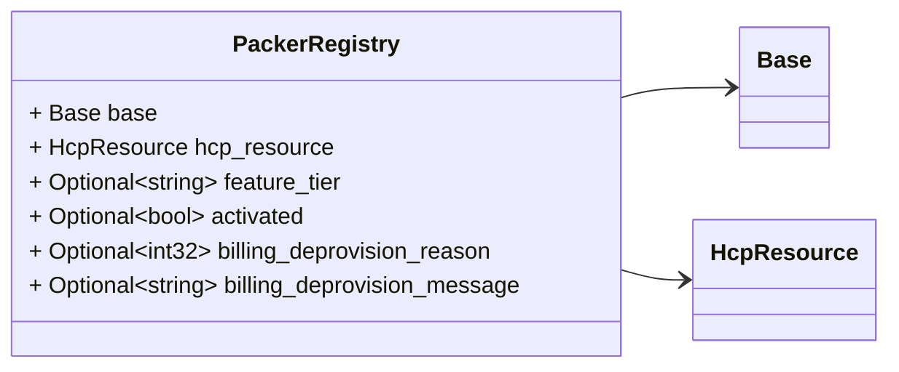
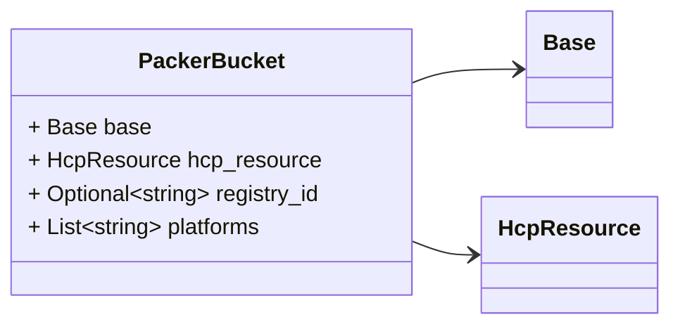
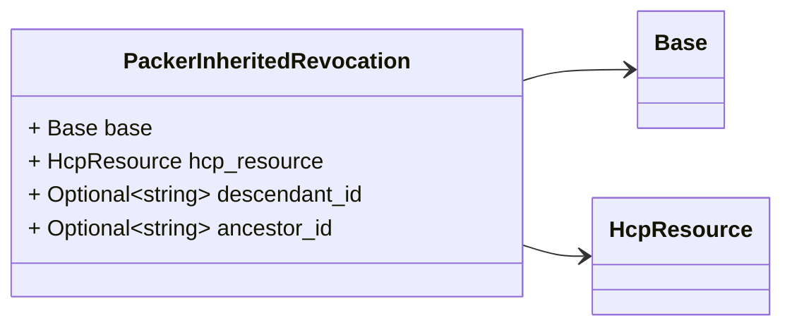
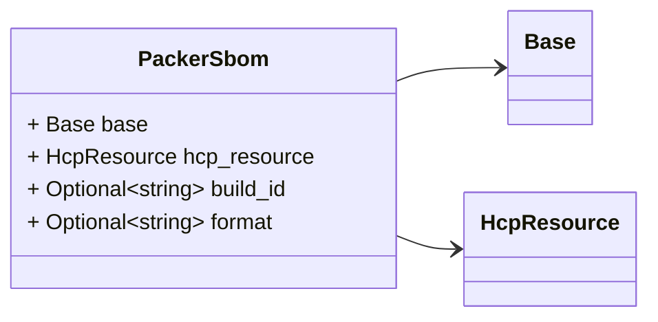
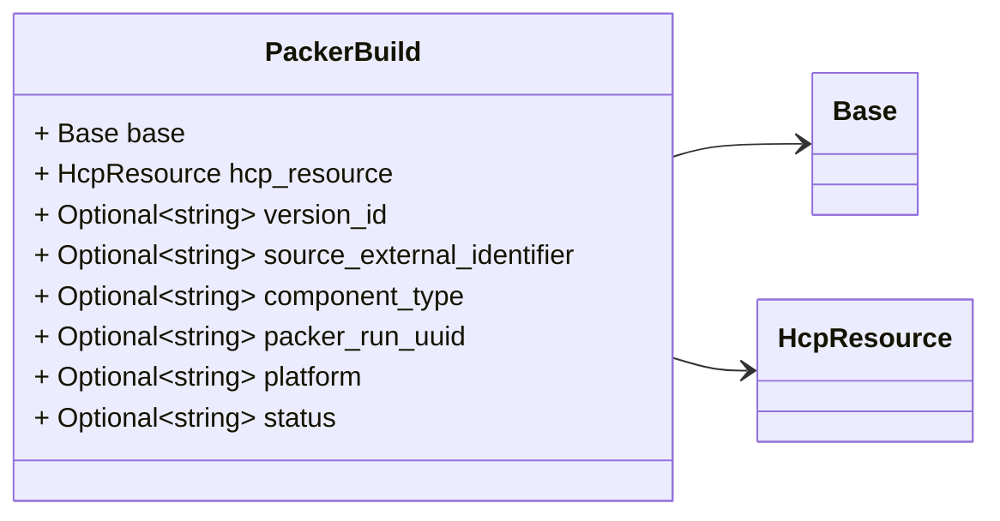
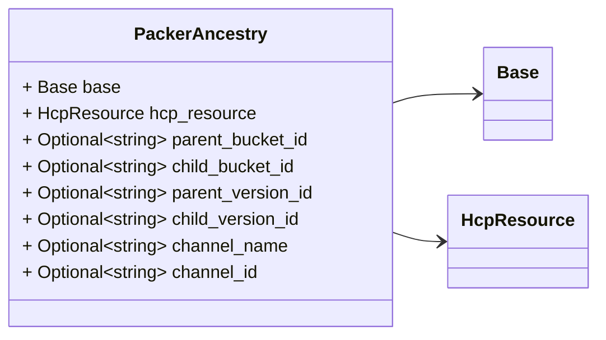
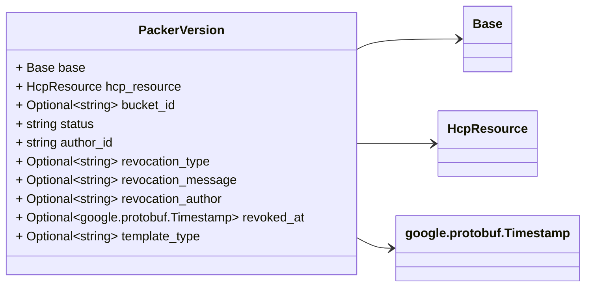
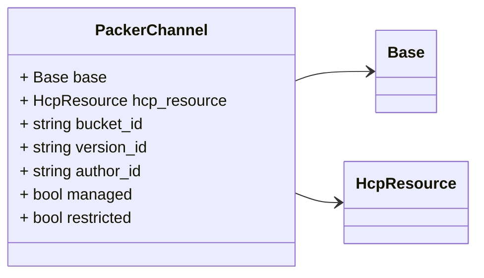
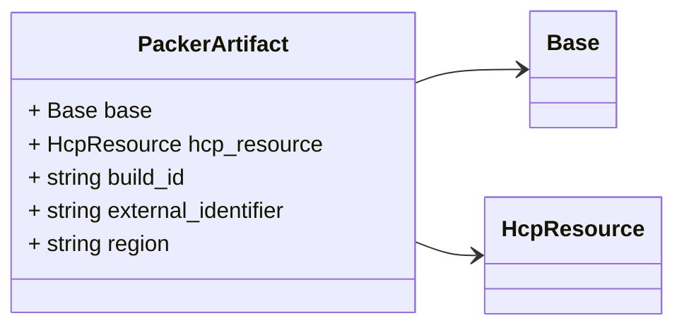

# Package: hashicorp.cloud.internal.infragraph.domain.v1

 

## Imports

| Import                                                       | Description |
|--------------------------------------------------------------|-------------|
| google/protobuf/timestamp.proto                              |             |
| hashicorp/cloud/internal/infragraph/domain/v1/base.proto     |             |
| hashicorp/cloud/internal/infragraph/domain/v1/hcp.proto      |             |
| hashicorp/cloud/internal/infragraph/options/v1/options.proto |             |

## Options

| Name       | Value                                                   | Description |
|------------|---------------------------------------------------------|-------------|
| go_package | github.com/hashicorp/cloud-infragraph/proto-internal/go |             |

### PackerRegistry Diagram

### PackerBucket Diagram

### PackerInheritedRevocation Diagram

### PackerSbom Diagram

### PackerBuild Diagram

### PackerAncestry Diagram

### PackerVersion Diagram

### PackerChannel Diagram

### PackerArtifact Diagram

## Message: PackerRegistry

FQN: hashicorp.cloud.internal.infragraph.domain.v1.PackerRegistry

PackerRegistry domain model message. 

| Field                       | Ordinal | Type        | Label    | Description |
|-----------------------------|---------|-------------|----------|-------------|
| base                        | 1       | Base        |          |             |
| hcp_resource                | 2       | HcpResource |          |             |
| feature_tier                | 3       | string      | Optional |             |
| activated                   | 4       | bool        | Optional |             |
| billing_deprovision_reason  | 5       | int32       | Optional |             |
| billing_deprovision_message | 6       | string      | Optional |             |

## Message: PackerBucket

FQN: hashicorp.cloud.internal.infragraph.domain.v1.PackerBucket

PackerBucket domain model message. 

| Field        | Ordinal | Type        | Label    | Description                                                                                            |
|--------------|---------|-------------|----------|--------------------------------------------------------------------------------------------------------|
| base         | 1       | Base        |          |                                                                                                        |
| hcp_resource | 2       | HcpResource |          |                                                                                                        |
| registry_id  | 3       | string      | Optional | id of the parent registry                                                                              |
| platforms    | 4       | string      | Repeated | array of the platforms associated with the bucket TODO: string array currently unsupported by codegen  |

## Message: PackerInheritedRevocation

FQN: hashicorp.cloud.internal.infragraph.domain.v1.PackerInheritedRevocation

PackerInheritedRevocation domain model message. 

| Field         | Ordinal | Type        | Label    | Description |
|---------------|---------|-------------|----------|-------------|
| base          | 1       | Base        |          |             |
| hcp_resource  | 2       | HcpResource |          |             |
| descendant_id | 3       | string      | Optional |             |
| ancestor_id   | 4       | string      | Optional |             |

## Message: PackerSbom

FQN: hashicorp.cloud.internal.infragraph.domain.v1.PackerSbom

PackerSBOM domain model message. 

| Field        | Ordinal | Type        | Label    | Description             |
|--------------|---------|-------------|----------|-------------------------|
| base         | 1       | Base        |          |                         |
| hcp_resource | 2       | HcpResource |          |                         |
| build_id     | 3       | string      | Optional | id of the parent build  |
| format       | 4       | string      | Optional | sbom format type        |

## Message: PackerBuild

FQN: hashicorp.cloud.internal.infragraph.domain.v1.PackerBuild

PackerBuild domain model message. 

| Field                      | Ordinal | Type        | Label    | Description               |
|----------------------------|---------|-------------|----------|---------------------------|
| base                       | 1       | Base        |          |                           |
| hcp_resource               | 2       | HcpResource |          |                           |
| version_id                 | 3       | string      | Optional | id of the parent version  |
| source_external_identifier | 4       | string      | Optional | id of the source          |
| component_type             | 5       | string      | Optional |                           |
| packer_run_uuid            | 6       | string      | Optional |                           |
| platform                   | 7       | string      | Optional |                           |
| status                     | 8       | string      | Optional |                           |

## Message: PackerAncestry

FQN: hashicorp.cloud.internal.infragraph.domain.v1.PackerAncestry

PackerAncestry domain model message. 

| Field             | Ordinal | Type        | Label    | Description              |
|-------------------|---------|-------------|----------|--------------------------|
| base              | 1       | Base        |          |                          |
| hcp_resource      | 2       | HcpResource |          |                          |
| parent_bucket_id  | 3       | string      | Optional | id of the parent bucket  |
| child_bucket_id   | 4       | string      | Optional | id of the child bucket   |
| parent_version_id | 5       | string      | Optional | id of the child bucket   |
| child_version_id  | 6       | string      | Optional | id of the child bucket   |
| channel_name      | 7       | string      | Optional |                          |
| channel_id        | 8       | string      | Optional | id of the channel        |

## Message: PackerVersion

FQN: hashicorp.cloud.internal.infragraph.domain.v1.PackerVersion

PackerVersion domain model message 

| Field              | Ordinal | Type                      | Label    | Description |
|--------------------|---------|---------------------------|----------|-------------|
| base               | 1       | Base                      |          |             |
| hcp_resource       | 2       | HcpResource               |          |             |
| bucket_id          | 3       | string                    | Optional |             |
| status             | 5       | string                    |          |             |
| author_id          | 6       | string                    |          |             |
| revocation_type    | 7       | string                    | Optional |             |
| revocation_message | 8       | string                    | Optional |             |
| revocation_author  | 9       | string                    | Optional |             |
| revoked_at         | 10      | google.protobuf.Timestamp | Optional |             |
| template_type      | 11      | string                    | Optional |             |

## Message: PackerChannel

FQN: hashicorp.cloud.internal.infragraph.domain.v1.PackerChannel

 

| Field        | Ordinal | Type        | Label | Description |
|--------------|---------|-------------|-------|-------------|
| base         | 1       | Base        |       |             |
| hcp_resource | 2       | HcpResource |       |             |
| bucket_id    | 3       | string      |       |             |
| version_id   | 4       | string      |       |             |
| author_id    | 5       | string      |       |             |
| managed      | 6       | bool        |       |             |
| restricted   | 7       | bool        |       |             |

## Message: PackerArtifact

FQN: hashicorp.cloud.internal.infragraph.domain.v1.PackerArtifact

PackerArtifact domain model message 

| Field               | Ordinal | Type        | Label | Description |
|---------------------|---------|-------------|-------|-------------|
| base                | 1       | Base        |       |             |
| hcp_resource        | 2       | HcpResource |       |             |
| build_id            | 3       | string      |       |             |
| external_identifier | 4       | string      |       |             |
| region              | 5       | string      |       |             |

<!-- Created by: Proto Diagram Tool -->
<!-- https://github.com/GoogleCloudPlatform/proto-gen-md-diagrams -->
