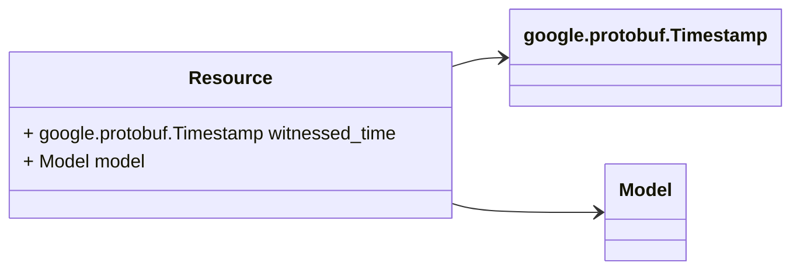

# Package: hashicorp.cloud.internal.infragraph.domain.v1

 

## Imports

| Import                                                    | Description |
|-----------------------------------------------------------|-------------|
| google/protobuf/timestamp.proto                           |             |
| hashicorp/cloud/internal/infragraph/domain/v1/model.proto |             |

## Options

| Name       | Value                                                   | Description |
|------------|---------------------------------------------------------|-------------|
| go_package | github.com/hashicorp/cloud-infragraph/proto-internal/go |             |

### Resource Diagram

## Message: Resource

FQN: hashicorp.cloud.internal.infragraph.domain.v1.Resource

 

| Field          | Ordinal | Type                      | Label | Description                                                                                                                                                           |
|----------------|---------|---------------------------|-------|-----------------------------------------------------------------------------------------------------------------------------------------------------------------------|
| witnessed_time | 1       | google.protobuf.Timestamp |       | witnessed_time is the time when this resource was last witnessed by the connector. The same clock should be used universally within the scope of a single connector.  |
| model          | 2       | Model                     |       | model is the domain model that represents this resource.                                                                                                              |

<!-- Created by: Proto Diagram Tool -->
<!-- https://github.com/GoogleCloudPlatform/proto-gen-md-diagrams -->
