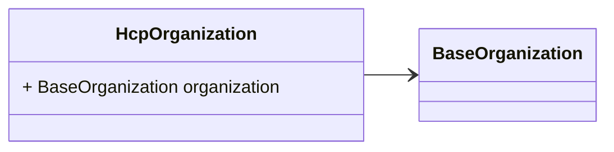
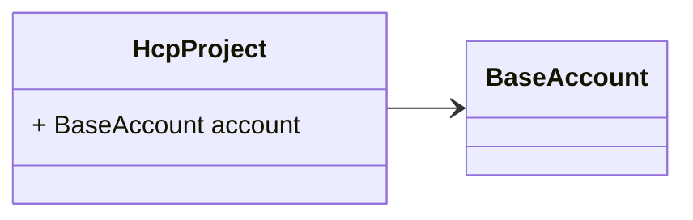
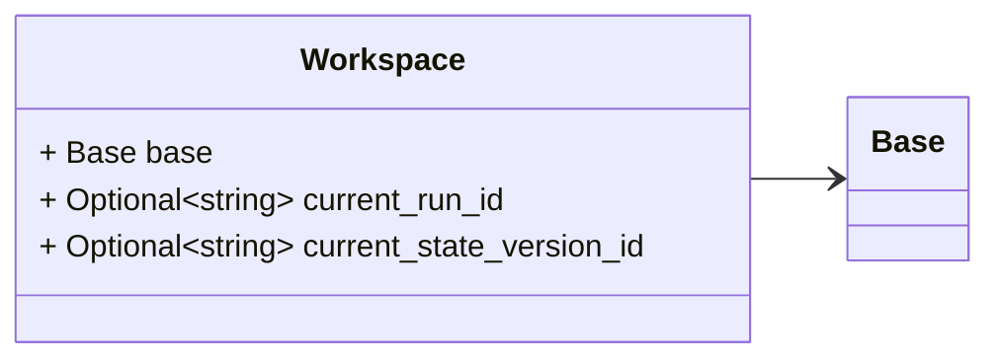
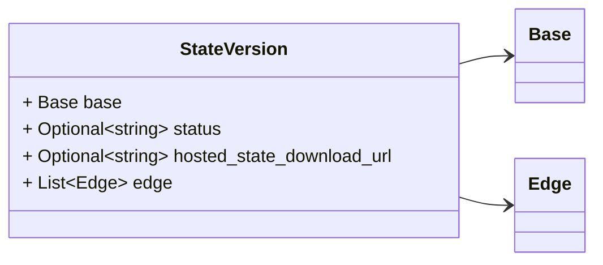

# Package: hashicorp.cloud.internal.infragraph.domain.v1

 

## Imports

| Import                                                       | Description |
|--------------------------------------------------------------|-------------|
| hashicorp/cloud/internal/infragraph/domain/v1/base.proto     |             |
| hashicorp/cloud/internal/infragraph/domain/v1/edge.proto     |             |
| hashicorp/cloud/internal/infragraph/domain/v1/hcp.proto      |             |
| hashicorp/cloud/internal/infragraph/options/v1/options.proto |             |

## Options

| Name       | Value                                                   | Description |
|------------|---------------------------------------------------------|-------------|
| go_package | github.com/hashicorp/cloud-infragraph/proto-internal/go |             |

### HcpOrganization Diagram

### HcpProject Diagram

### Workspace Diagram

### StateVersion Diagram

## Message: HcpOrganization

FQN: hashicorp.cloud.internal.infragraph.domain.v1.HcpOrganization

HcpOrganization is a type containing HCP TF or TFE organization specific fields. 

| Field        | Ordinal | Type             | Label | Description |
|--------------|---------|------------------|-------|-------------|
| organization | 1       | BaseOrganization |       |             |

## Message: HcpProject

FQN: hashicorp.cloud.internal.infragraph.domain.v1.HcpProject

HcpProject is a type containing HCP TF or TFE Project specific fields. 

| Field   | Ordinal | Type        | Label | Description |
|---------|---------|-------------|-------|-------------|
| account | 1       | BaseAccount |       |             |

## Message: Workspace

FQN: hashicorp.cloud.internal.infragraph.domain.v1.Workspace

Workspace is a type containing Terraform Workspace specific fields. 

| Field                    | Ordinal | Type   | Label    | Description                                    |
|--------------------------|---------|--------|----------|------------------------------------------------|
| base                     | 1       | Base   |          | project_id is mapped to Account ID in base     |
| current_run_id           | 2       | string | Optional |                                                |
| current_state_version_id | 3       | string | Optional | the current state version id of the workspace  |

## Message: StateVersion

FQN: hashicorp.cloud.internal.infragraph.domain.v1.StateVersion

StateVersion is a type containing HCP State Version specific fields. 

| Field                     | Ordinal | Type   | Label    | Description |
|---------------------------|---------|--------|----------|-------------|
| base                      | 1       | Base   |          |             |
| status                    | 2       | string | Optional |             |
| hosted_state_download_url | 3       | string | Optional |             |
| edge                      | 4       | Edge   | Repeated |             |

<!-- Created by: Proto Diagram Tool -->
<!-- https://github.com/GoogleCloudPlatform/proto-gen-md-diagrams -->
